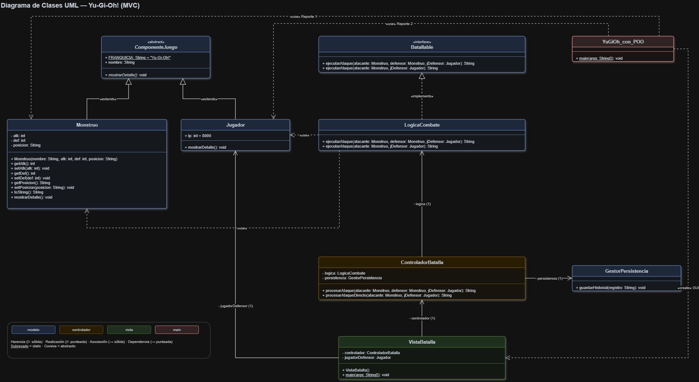
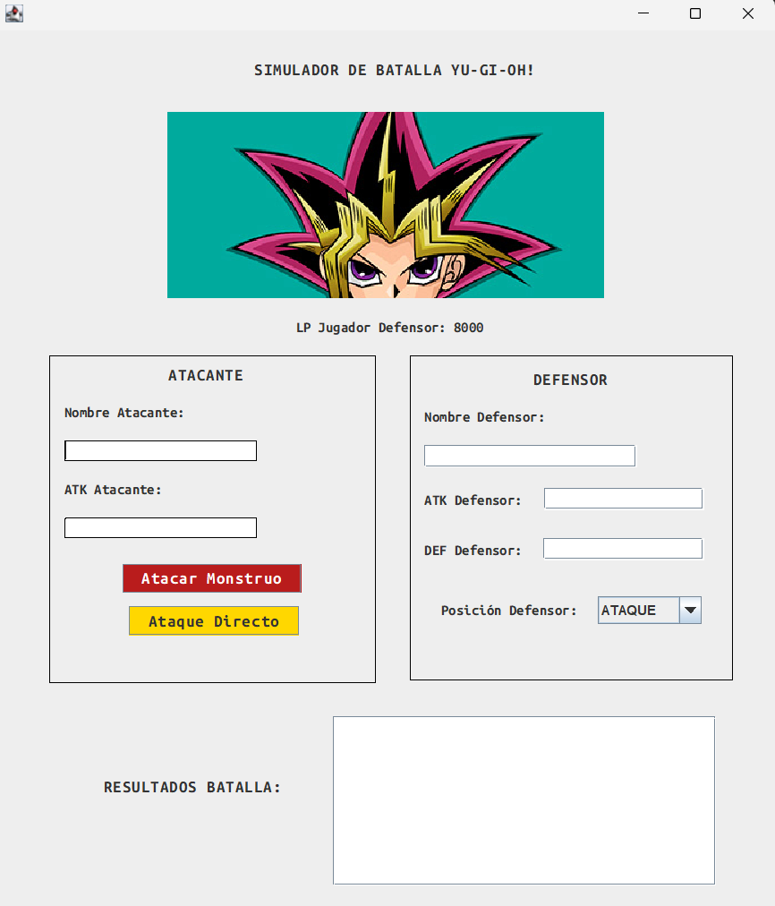
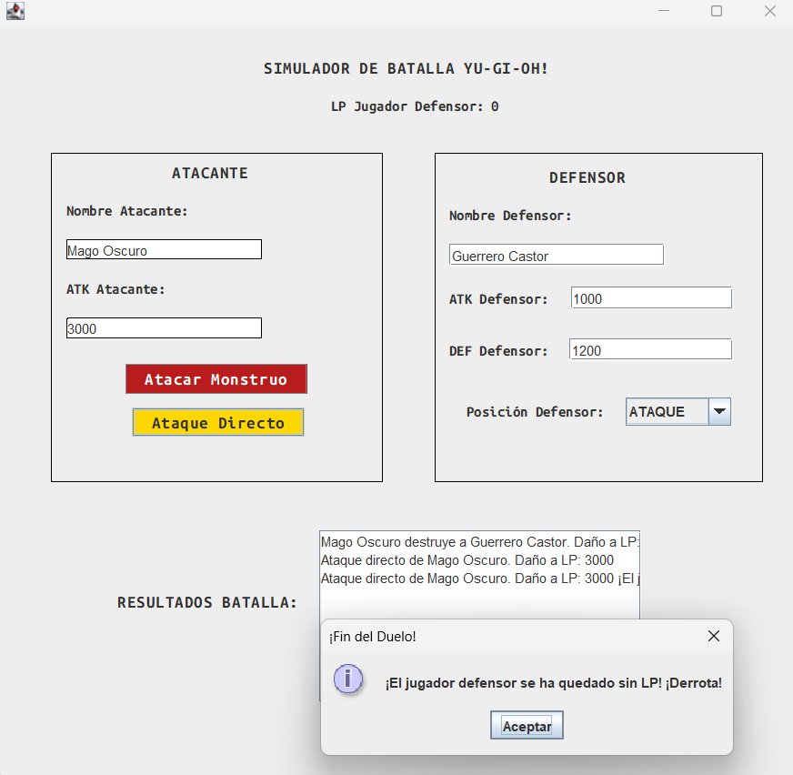

# 🃏 Simulador de Combate Yu-Gi-Oh! — Fase de Batalla (MVC)

Aplicación de escritorio en **Java (Maven + Swing + JUnit 5)** que simula la **Fase de Batalla** del juego de cartas *Yu-Gi-Oh!*, implementando el patrón arquitectónico Modelo-Vista-Controlador (MVC) y persistencia en archivos planos.

## 🏗️ Arquitectura del Proyecto (Patrón MVC)

El sistema separa estrictamente la lógica de negocio, la persistencia, la interfaz gráfica y los recursos visuales en paquetes y directorios independientes:

```text
YuGiOh_con_POO/
├── Diagrams/                        # Diagramas UML (.drawio / .png) y capturas de evolución de la GUI
├── src/main/java/
│   ├── modelo/
│   │   ├── ComponenteJuego.java     # Clase abstracta base (static final FRANQUICIA, abstract mostrarDetalle)
│   │   ├── Monstruo.java            # Subclase 1: Único constructor explícito, getters, setters y toString()
│   │   ├── Jugador.java             # Subclase 2: Gestión de Life Points (LP = 8000) y sobreescritura
│   │   ├── Batallable.java          # Interfaz con polimorfismo de sobrecarga (ejecutarAtaque)
│   │   ├── LogicaCombate.java       # Motor oficial de cálculo de daño, límite en 0 LP y detección de derrota
│   │   └── GestorPersistencia.java  # Registro histórico de turnos en historial_combate.txt
│   ├── controlador/
│   │   └── ControladorBatalla.java  # Orquestador entre la Vista, LogicaCombate y GestorPersistencia
│   ├── vista/
│   │   ├── VistaBatalla.form        # Diseño visual construido con NetBeans JFrame Form Designer
│   │   └── VistaBatalla.java        # Ventana principal de batalla con paneles de Atacante/Defensor y validaciones
│   └── com/mycompany/yugioh_con_poo/
│       └── YuGiOh_con_POO.java      # Clase Main: Ejecuta los 2 reportes dinámicos (ArrayList) y lanza la GUI
├── src/main/resources/
│   └── Imagen.jpg                   # Recurso gráfico temático integrado en la cabecera de la GUI
├── src/test/java/
│   └── modelo/
│       └── LogicaCombateTest.java   # Suite de pruebas unitarias automatizadas con JUnit 5
└── historial_combate.txt            # Archivo de persistencia generado con el registro de cada duelo
```

## Evolución Visual e Ingeniería de Software

### 1. Diagrama de Clases UML


### 2. Interfaz Gráfica (`VistaBatalla`)

#### Versión Final (Diseño Temático y Paneles Estructurados)


#### Prototipo Inicial (Pruebas de Funcionalidad)


## Cumplimiento de Requerimientos

### 1. Diseño UML y Principios de POO

* **Clases e interfaz implementada:** El sistema cuenta con 9 componentes distribuidos en el diagrama (`ComponenteJuego`, `Monstruo`, `Jugador`, `Batallable`, `LogicaCombate`, `GestorPersistencia`, `ControladorBatalla`, `VistaBatalla` y `YuGiOh_con_POO`).
* **Relaciones completas:**
  * **Herencia:** `Monstruo` y `Jugador` extienden de la clase abstracta `ComponenteJuego`.
  * **Realización (Interfaz):** `LogicaCombate` implementa `Batallable`.
  * **Asociación:** `ControladorBatalla` mantiene instancias de `LogicaCombate` y `GestorPersistencia`; `VistaBatalla` se asocia con `ControladorBatalla`.
  * **Dependencia:** `LogicaCombate` y `YuGiOh_con_POO` operan sobre instancias de `Monstruo` y `Jugador`.
* **Modificadores exigidos:** Uso de `public static final String FRANQUICIA = "Yu-Gi-Oh!"` y método `public abstract void mostrarDetalle()` en `ComponenteJuego`.
* **Polimorfismo:**
  * **Sobrecarga (*Overloading*):** Métodos `ejecutarAtaque(Monstruo, Monstruo, Jugador)` y `ejecutarAtaque(Monstruo, Jugador)` para ataque directo.
  * **Sobreescritura (*Overriding*):** Implementación de `@Override mostrarDetalle()` en `Monstruo` y `Jugador`, y `@Override ejecutarAtaque(...)` en `LogicaCombate`.
* **Restricción estricta de métodos y constructores:** Solo la subclase `Monstruo` define constructor explícito, métodos `getters`, `setters` y `toString()`.
* **Reportes en estructuras dinámicas (`Main`):** La clase `YuGiOh_con_POO` almacena objetos en `ArrayList<Monstruo>` y `ArrayList<Jugador>` e imprime dos reportes detallados por consola al iniciar.

### 2. Requerimientos Funcionales y Reglas de Combate

* **RF1 (Gestión de Jugadores):** Inicialización de duelistas con `8000 LP` y control de límite mínimo en `0 LP` con aviso emergente de derrota.
* **RF2 (Gestión de Cartas):** Creación de monstruos con Nombre, ATK, DEF y Posición (`ATAQUE` / `DEFENSA`).
* **RF3 (Lógica de Combate):**
  * **Ataque vs. Ataque:** Si `ATK Atacante > ATK Defensor`, el monstruo defensor es destruido y el jugador defensor pierde LP equivalentes a la diferencia.
  * **Ataque vs. Defensa:** Si `ATK Atacante > DEF Defensor`, el monstruo defensor es destruido sin reducir los LP del jugador defensor.
  * **Ataque Directo:** Si no hay monstruo defensor, el daño impacta directamente los LP del jugador rival.
* **RF4 (Persistencia):** Cada turno se agrega automáticamente al archivo `historial_combate.txt`.

### 3. Pruebas Unitarias (JUnit 5)

La clase `LogicaCombateTest` valida matemáticamente y de forma independiente:

1. Reducción de LP en ataque directo (`testAtaqueDirectoReduceLP`).
2. Cálculo de diferencia de ATK y destrucción en Ataque vs. Ataque (`testAtaqueVsAtaque`).
3. Destrucción sin daño a LP en Ataque vs. Defensa (`testAtaqueVsDefensaNoReduceLP`).

### 4. Control de Versiones con Git y GitHub

* Desarrollo estructurado en rama personal (`juan_torres_dev`) con historial incremental de commits y fusión hacia `main` mediante **Pull Request**.

## ▶️ Ejecución del Proyecto y Pruebas

1. **Abrir en NetBeans:** `File -> Open Project` y seleccionar la carpeta del proyecto Maven `YuGiOh_con_POO`.
2. **Ejecutar Pruebas Unitarias (JUnit 5):** Clic derecho sobre el proyecto -> `Test` (o `Alt + F6`).
3. **Ejecutar el Simulador:** Clic derecho sobre el proyecto -> `Run` (o `F6`).

## Autor

* **Estudiante:** Juan Sebastián Torres Pantoja
* **Programa:** Ingeniería de Datos e Inteligencia Artificial
* **Institución:** Universidad Autónoma de Occidente (UAO)